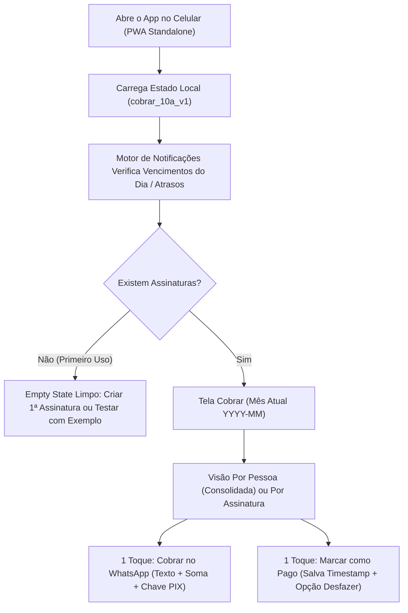
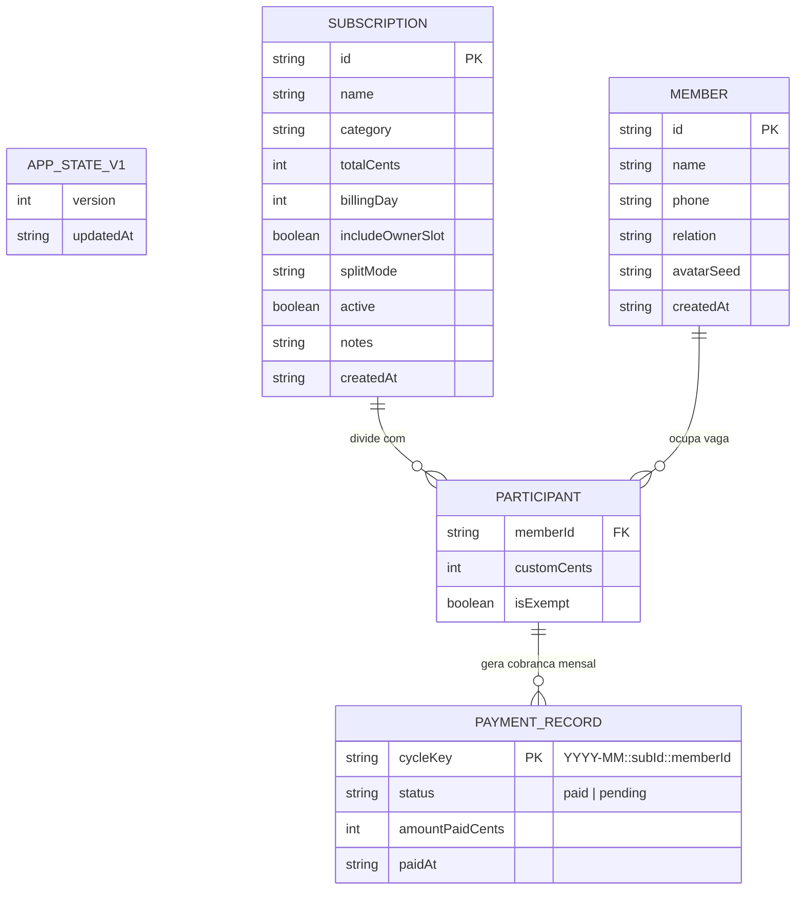

# Arquitetura de Planejamento — Fase Zero (Cota · 10ATIVAS V2)

Documento de referência arquitetural (**PDR**, **TDR**, **Fluxo do Usuário** e **Esquema de Dados LocalStorage**) do aplicativo **Cota**.

---

## 1. PDR (Product Design Record)

### 1.1 Problema Real
Quem paga o plano família de serviços digitais (YouTube Premium, Spotify, Netflix, iCloud+, Max, Canva, Nintendo Switch Online) quase sempre esquece a data de vencimento de cada serviço ou perde o controle de quem já transferiu o PIX no mês atual — acabando no prejuízo por esquecimento.

### 1.2 Objetivo do Produto
Entregar um web app **mobile-first instalável (PWA)**, rápido, limpo e 100% privado no próprio aparelho, focado exclusivamente em:
1. Mostrar em menos de 2 segundos **quem falta pagar no mês atual** e quanto falta receber.
2. Disparar a **cobrança no WhatsApp em 1 toque**, já somando todas as assinaturas que a pessoa divide naquele mês e incluindo a chave PIX.
3. Avisar via **notificações nativas no celular** nos dias de vencimento ou quando houver atraso.
4. Marcar pagamentos recebidos com 1 toque, mantendo histórico mensal limpo (`YYYY-MM`).

### 1.3 Escopo Funcional (Foco Enxuto)
- **Aba Cobrar (Home):** Resumo financeiro do mês em painel Obsidian (`Falta receber`, `Recebido`, `Sua economia`), alternância entre visão **Por Pessoa** (cobrança consolidada) e **Por Assinatura**, filtro de pendentes e ações rápidas (`WhatsApp` + `Confirmar pagamento`).
- **Aba Assinaturas:** Cadastro rápido com atalhos de serviços populares, dia do vencimento (`1–31`), divisão igualitária automática (com opção de incluir ou não a vaga do titular) ou valores personalizados por participante, além de suporte a vagas de cortesia (isentos).
- **Aba Família:** Gestão das pessoas que dividem planos com você (nome, WhatsApp, apelido/parentesco e vínculo direto às assinaturas).
- **Aba Ajustes:** Configuração da Chave PIX, template editável da mensagem de WhatsApp, central de Notificações do aparelho (permissão, antecedência, alerta de atrasos e disparo de teste), instalação PWA (Android/iOS), alternância de tema (Claro / Obsidian Dark) e Backup Local (Exportar/Importar `.json`).

---

## 2. TDR (Technical Design Record)

### 2.1 Stack Tecnológica
- **Framework:** Next.js 16 (App Router) + React 19 + TypeScript 5 (`strict: true`).
- **Estilização:** Tailwind CSS v4 + CSS Custom Properties oficiais **10ATIVAS V2**.
- **Tipografia:** `Sora` + `Geist Mono` (`next/font/google`).
- **Ícones:** `@phosphor-icons/react` (zero emojis na interface) + ativos oficiais 10Ativas (`/brand/*`).
- **Animações:** `framer-motion` para transições de abas, bottom sheets mobile e micro-interações táteis.
- **Armazenamento:** `localStorage` tipado e versionado (`cobrar_10a_v1`), cálculos monetários em **centavos inteiros** (zero erro de ponto flutuante IEEE 754).
- **PWA & Offline:** `public/manifest.webmanifest` + `public/sw.js` (Service Worker com cache estático e suporte a `showNotification`).

---

## 3. Fluxo do App (User Journey)

---

## 4. Esquema de Dados Local (`localStorage: cobrar_10a_v1`)

